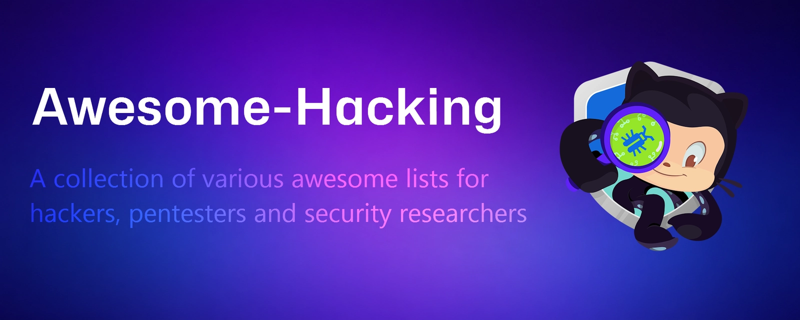

# MAX-HACK-TOOLS

**A consolidated mega-repo of awesome hacking, pentesting, red team, and security-research lists — merged into one repository.**

This repository combines [N4P1x/Awesome-Hacking](https://github.com/N4P1x/Awesome-Hacking) (a fork of [Hack-with-Github/Awesome-Hacking](https://github.com/Hack-with-Github/Awesome-Hacking), ~124k stars) with deep-searched, similar security awesome-lists from across GitHub. Every source is preserved verbatim inside `sources/<name>/`, so nothing is lost and every list remains attributable to its original author.

---

## What's inside

| #   | Source (stars)                                                                                                               | Description                                                                                                                                                                    | Local path                                   | License     |
| --- | ---------------------------------------------------------------------------------------------------------------------------- | ------------------------------------------------------------------------------------------------------------------------------------------------------------------------------ | -------------------------------------------- | ----------- |
| 1   | [Hack-with-Github/Awesome-Hacking](https://github.com/Hack-with-Github/Awesome-Hacking) (124,314)                            | A collection of various awesome lists for hackers, pentesters & security researchers.                                                                                          | `./` (root)                                  | CC0-1.0     |
| 2   | [0xsyr0/Awesome-Cybersecurity-Handbooks](https://github.com/0xsyr0/Awesome-Cybersecurity-Handbooks) (4,162)                  | Personal red-team / CTF notes and living handbooks for offensive & defensive security.                                                                                         | `sources/awesome-cybersecurity-handbooks/`   | GPL-3.0     |
| 3   | [scadastrangelove/awesome-ai-security-tools](https://github.com/scadastrangelove/awesome-ai-security-tools) (1,709)          | Curated list of AI security and AI-assisted cybersecurity tools (red-teaming, fuzzing, SAST, supply chain, SOC/SIEM).                                                          | `sources/awesome-ai-security-tools/`         | NOASSERTION |
| 4   | [hexsecs/awesome-embedded-security](https://github.com/hexsecs/awesome-embedded-security) (72)                               | Embedded & IoT security: firmware analysis, reverse engineering, hardware hacking, SDR, wireless protocols.                                                                    | `sources/awesome-embedded-security/`         | CC0-1.0     |
| 5   | [eudk/awesome-cybersecurity-tools](https://github.com/eudk/awesome-cybersecurity-tools) (39)                                 | Practical catalog of security tools for red/blue teams: recon, web/API, cloud, containers, AD, DFIR.                                                                           | `sources/awesome-cybersecurity-tools/`       | CC0-1.0     |
| 6   | [Prashant-Bhapkar/Awesome-Security-Resources](https://github.com/Prashant-Bhapkar/Awesome-Security-Resources) (32)           | Vulnerability assessment and penetration testing tools and resources.                                                                                                          | `sources/awesome-security-resources/`        | MIT         |
| 7   | [frangelbarrera/Awesome-Hacking-with-AI](https://github.com/frangelbarrera/Awesome-Hacking-with-AI) (47)                     | AI for security and security for AI: defensive research, agent safety, MCP security, AI red-teaming, detection engineering.                                                    | `sources/awesome-hacking-with-ai/`           | MIT         |
| 8   | [ClaudiasLibrary/hacking-101](https://github.com/ClaudiasLibrary/hacking-101) (23)                                           | Comprehensive beginner-to-elite guide to becoming a hacker: skills, tools, techniques.                                                                                         | `sources/hacking-101/`                       | —           |
| 9   | [SagarBiswas-MultiHAT/awesome-cybersecurity-paths](https://github.com/SagarBiswas-MultiHAT/awesome-cybersecurity-paths) (31) | Complete cybersecurity career roadmap: 36 roles, 150+ tools, 50+ certifications across pentest, red team, bug bounty, SOC, DFIR, cloud, DevSecOps, threat hunting, OSINT, GRC. | `sources/awesome-cybersecurity-paths/`       | NOASSERTION |
| 10  | [akashrpatil/awesome-offensive-security-skills](https://github.com/akashrpatil/awesome-offensive-security-skills) (14)       | 191+ battle-tested cybersecurity skills for AI agents — bug bounty, pentesting, red team, AI red teaming, MITRE ATT&CK mapped.                                                 | `sources/awesome-offensive-security-skills/` | Apache-2.0  |
| 11  | [vitorfhc/awesome-autonomous-hacking-agents](https://github.com/vitorfhc/awesome-autonomous-hacking-agents) (8)              | AI-agent papers for building autonomous security bots: offensive AI, agent architecture, memory, tool use, benchmarks.                                                         | `sources/awesome-autonomous-hacking-agents/` | —           |
| 12  | [geevarghesekthomas84-sys/awesome-red-team](https://github.com/geevarghesekthomas84-sys/awesome-red-team) (2)                | Red team / offensive security resources organized by MITRE ATT&CK Kill Chain phases.                                                                                           | `sources/awesome-red-team/`                  | MIT         |
| 13  | [cveburak/awesome-cybersecurity](https://github.com/cveburak/awesome-cybersecurity) (2)                                      | 239+ free & paid cybersecurity resources: pentest, red team, bug bounty, SOC, DFIR, CTF, OWASP, MITRE ATT&CK.                                                                  | `sources/awesome-cybersecurity/`             | CC0-1.0     |
| 14  | [spinov001-art/awesome-security-tools-2026](https://github.com/spinov001-art/awesome-security-tools-2026) (7)                | 150+ cybersecurity tools, frameworks, and resources for 2026: pentesting, vuln scanning, network, web, SIEM, threat intel, forensics, cloud, container, API.                   | `sources/awesome-security-tools-2026/`       | —           |

**Total: 14 source repositories consolidated into 1.**

---

## Original Awesome-Hacking categories (root)

The root of this repo contains the original [Awesome-Hacking](https://github.com/Hack-with-Github/Awesome-Hacking) content, organized into two tables:

### Awesome Repositories

| Repository                                                                                                       | Description                                                                                            |
| ---------------------------------------------------------------------------------------------------------------- | ------------------------------------------------------------------------------------------------------ |
| [Android Security](https://github.com/ashishb/android-security-awesome)                                          | Collection of Android security related resources                                                       |
| [AppSec](https://github.com/paragonie/awesome-appsec)                                                            | Resources for learning about application security                                                      |
| [Asset Discovery](https://github.com/redhuntlabs/Awesome-Asset-Discovery)                                        | List of resources which help during asset discovery phase of a security assessment engagement          |
| [Bug Bounty](https://github.com/djadmin/awesome-bug-bounty)                                                      | List of Bug Bounty Programs and write-ups from the Bug Bounty hunters                                  |
| [Cellular Hacking](https://github.com/W00t3k/Awesome-Cellular-Hacking)                                           | Hacking research in the 3G/4G/5G cellular security space                                               |
| [CI/CD Attacks](https://github.com/TupleType/awesome-cicd-attacks)                                               | Offensive research of CI/CD systems and deployment processes                                           |
| [CTF](https://github.com/apsdehal/awesome-ctf)                                                                   | List of CTF frameworks, libraries, resources and softwares                                             |
| [Cyber Security University](https://github.com/brootware/awesome-cyber-security-university)                      | Free educational resources that focus on learning cybersecurity by doing                               |
| [Cyber Skills](https://github.com/joe-shenouda/awesome-cyber-skills)                                             | Curated list of hacking environments where you can train your cyber skills legally and safely          |
| [Cybersources](https://github.com/bst04/CyberSources)                                                            | A collection of all types of tools and resources for cybersecurity                                     |
| [Detection Engineering](https://github.com/infosecB/awesome-detection-engineering)                               | Resources for designing, building, and operating detective cybersecurity controls                      |
| [DevSecOps](https://github.com/devsecops/awesome-devsecops)                                                      | List of awesome DevSecOps tools with the help from community experiments and contributions             |
| [Drone Hacking](https://github.com/nicholasaleks/Awesome-Drone-Hacking)                                          | List of Drone hacking tools and resources                                                              |
| [Embedded and IoT Security](https://github.com/fkie-cad/awesome-embedded-and-iot-security)                       | A curated list of awesome resources about embedded and IoT security                                    |
| [Fuzzing](https://github.com/secfigo/Awesome-Fuzzing)                                                            | List of fuzzing resources for learning Fuzzing and initial phases of Exploit Development               |
| [Hacking](https://github.com/carpedm20/awesome-hacking)                                                          | List of awesome Hacking tutorials, tools and resources                                                 |
| [Honeypots](https://github.com/paralax/awesome-honeypots)                                                        | List of honeypot resources                                                                             |
| [Incident Response](https://github.com/meirwah/awesome-incident-response)                                        | List of tools for incident response                                                                    |
| [Industrial Control System Security](https://github.com/hslatman/awesome-industrial-control-system-security)     | List of resources related to Industrial Control System (ICS) security                                  |
| [InfoSec](https://github.com/onlurking/awesome-infosec)                                                          | List of awesome infosec courses and training resources                                                 |
| [IoT and Hardware Security](https://github.com/kayranfatih/awesome-iot-and-hardware-security)                    | Collection of tools, books, resources and software about IoT and hardware security                     |
| [Mainframe Hacking](https://github.com/samanL33T/Awesome-Mainframe-Hacking)                                      | List of Awesome Mainframe Hacking/Pentesting Resources                                                 |
| [Malware Analysis](https://github.com/rshipp/awesome-malware-analysis)                                           | List of awesome malware analysis tools and resources                                                   |
| [Malware Persistence](https://github.com/Karneades/awesome-malware-persistence)                                  | Techniques adversaries use to maintain system access across restarts                                   |
| [Node.js Security](https://github.com/lirantal/awesome-nodejs-security)                                          | Curated list of tools, security incidents and other resources around Node.js security                  |
| [OSINT](https://github.com/jivoi/awesome-osint)                                                                  | List of amazingly awesome Open Source Intelligence (OSINT) tools and resources                         |
| [OSX and iOS Security](https://github.com/ashishb/osx-and-ios-security-awesome)                                  | OSX and iOS related security tools                                                                     |
| [Password Cracking](https://github.com/n0kovo/awesome-password-cracking)                                         | Tools and resources for recovering passwords                                                           |
| [Pcaptools](https://github.com/caesar0301/awesome-pcaptools)                                                     | Collection of tools developed by researchers in the Computer Science area to process network traces    |
| [Pentest](https://github.com/enaqx/awesome-pentest)                                                              | List of awesome penetration testing resources, tools and other shiny things                            |
| [PHP Security](https://github.com/ziadoz/awesome-php#security)                                                   | Libraries for generating secure random numbers, encrypting data and scanning for vulnerabilities       |
| [Prompt Injection](https://github.com/Joe-B-Security/awesome-prompt-injection)                                   | Prompt injection vulnerabilities targeting AI and LLM systems                                          |
| [Real-time Communications hacking & pentesting resources](https://github.com/EnableSecurity/awesome-rtc-hacking) | Covers VoIP, WebRTC and VoLTE security related topics                                                  |
| [Red Teaming Toolkit](https://github.com/infosecn1nja/Red-Teaming-Toolkit)                                       | Cutting-edge open-source security tools (OST) for red teamers and threat hunters                       |
| [Reinforcement Learning for Cyber Security](https://github.com/Kim-Hammar/awesome-rl-for-cybersecurity)          | List of awesome reinforcement learning for security resources                                          |
| [Reversing](https://github.com/HACKE-RC/awesome-reversing)                                                       | Collection of resources to learn Reverse Engineering from start                                        |
| [Sec Talks](https://github.com/PaulSec/awesome-sec-talks)                                                        | List of awesome security talks                                                                         |
| [SecLists](https://github.com/danielmiessler/SecLists)                                                           | Collection of multiple types of lists used during security assessments                                 |
| [Security](https://github.com/sbilly/awesome-security)                                                           | Collection of awesome software, libraries, documents, books, resources and cools stuffs about security |
| [Social Engineering](https://github.com/giuliacassara/awesome-social-engineering)                                | List of awesome social engineering resources                                                           |
| [Static Analysis](https://github.com/analysis-tools-dev/static-analysis)                                         | List of static analysis tools, linters and code quality checkers for various programming languages     |
| [The Art of Hacking Series](https://github.com/The-Art-of-Hacking/h4cker)                                        | List of resources includes thousands of cybersecurity-related references and resources                 |
| [Threat Intelligence](https://github.com/hslatman/awesome-threat-intelligence)                                   | List of Awesome Threat Intelligence resources                                                          |
| [Vehicle Security](https://github.com/jaredthecoder/awesome-vehicle-security)                                    | List of resources for learning about vehicle security and car hacking                                  |
| [Web Hacking](https://github.com/infoslack/awesome-web-hacking)                                                  | List of web application security                                                                       |
| [Web3 Security](https://github.com/Anugrahsr/Awesome-web3-Security)                                              | A curated list of web3 Security materials and resources For Pentesters and Bug Hunters.                |
| [YARA](https://github.com/InQuest/awesome-yara)                                                                  | List of awesome YARA rules, tools, and people                                                          |

### Other Useful Repositories

| Repository                                                                                   | Description                                                                                                   |
| -------------------------------------------------------------------------------------------- | ------------------------------------------------------------------------------------------------------------- |
| [AI Security](https://github.com/DeepSpaceHarbor/Awesome-AI-Security)                        | Curated list of AI security resources                                                                         |
| [Annual Security Reports](https://github.com/jacobdjwilson/awesome-annual-security-reports)  | Cybersecurity trends, insights, and challenges from annual reports                                            |
| [API Security Checklist](https://github.com/shieldfy/API-Security-Checklist)                 | Checklist of the most important security countermeasures when designing, testing, and releasing your API      |
| [APT Notes](https://github.com/kbandla/APTnotes)                                             | Various public documents, whitepapers and articles about APT campaigns                                        |
| [Bug Bounty Reference](https://github.com/ngalongc/bug-bounty-reference)                     | List of bug bounty write-up categorized by bug nature                                                         |
| [Capsulecorp Pentest](https://github.com/r3dy/capsulecorp-pentest)                           | Vagrant+Ansible virtual network penetration testing lab                                                       |
| [Cryptography](https://github.com/sobolevn/awesome-cryptography)                             | Cryptography resources and tools                                                                              |
| [CVE PoC](https://github.com/trickest/cve)                                                   | List of CVE Proof of Concepts (PoCs) updated daily by Trickest                                                |
| [CyberChef](https://gchq.github.io/CyberChef/)                                               | A simple, intuitive web app for analysing and decoding data                                                   |
| [Detection Lab](https://github.com/clong/DetectionLab)                                       | Vagrant & Packer scripts to build a lab environment complete with security tooling and logging best practices |
| [Executable Packing](https://github.com/packing-box/awesome-executable-packing)              | Resources about executable packing and unpacking                                                              |
| [Forensics](https://github.com/Cugu/awesome-forensics)                                       | List of awesome forensic analysis tools and resources                                                         |
| [Free Programming Books](https://github.com/EbookFoundation/free-programming-books)          | Free programming books for developers                                                                         |
| [GTFOBins](https://gtfobins.github.io)                                                       | A curated list of Unix binaries that can be exploited by an attacker to bypass local security restrictions    |
| [Hacker101](https://github.com/Hacker0x01/hacker101)                                         | A free class for web security by HackerOne                                                                    |
| [Infosec Getting Started](https://github.com/gradiuscypher/infosec_getting_started)          | A collection of resources, documentation, links, etc to help people learn about Infosec                       |
| [Infosec Reference](https://github.com/rmusser01/Infosec_Reference)                          | Information Security Reference That Doesn't Suck                                                              |
| [IOC](https://github.com/sroberts/awesome-iocs)                                              | Collection of sources of indicators of compromise                                                             |
| [Linux Kernel Exploitation](https://github.com/xairy/linux-kernel-exploitation)              | Links related to Linux kernel fuzzing and exploitation                                                        |
| [Machine Learning for Cyber Security](https://github.com/jivoi/awesome-ml-for-cybersecurity) | Curated list of tools and resources related to ML for cyber security                                          |
| [Payloads](https://github.com/foospidy/payloads)                                             | Collection of web attack payloads                                                                             |
| [PayloadsAllTheThings](https://github.com/swisskyrepo/PayloadsAllTheThings)                  | List of useful payloads and bypass for Web Application Security and Pentest/CTF                               |
| [Pentest Wiki](https://github.com/nixawk/pentest-wiki)                                       | A free online security knowledge library for pentesters / researchers                                         |
| [Probable Wordlists](https://github.com/berzerk0/Probable-Wordlists)                         | Wordlists sorted by probability originally created for password generation and testing                        |
| [Red Team Physical Tools](https://github.com/DavidProbinsky/RedTeam-Physical-Tools)          | Curated list of tools for physical security, red teaming, and tactical covert entry                           |
| [Reverse Engineering](https://github.com/onethawt/reverseengineering-reading-list)           | List of Reverse Engineering articles, books, and papers                                                       |
| [RFSec-ToolKit](https://github.com/cn0xroot/RFSec-ToolKit)                                   | Collection of Radio Frequency Communication Protocol Hacktools                                                |
| [Security Cheatsheets](https://github.com/OWASP/CheatSheetSeries)                            | OWASP Cheat Sheet Series for application security                                                             |
| [Shell](https://github.com/alebcay/awesome-shell)                                            | List of awesome command-line frameworks, toolkits, guides and gizmos                                          |
| [Suricata](https://github.com/satta/awesome-suricata)                                        | Suricata IDS/IPS and network security monitoring resources                                                    |
| [ThreatHunter-Playbook](https://github.com/OTRF/ThreatHunter-Playbook)                       | A Threat hunter's playbook to aid the development of techniques and hypothesis for hunting campaigns          |
| [Tor](https://github.com/polycarbohydrate/awesome-tor)                                       | Resources about the Tor network and anonymous communication                                                   |
| [Vulhub](https://github.com/vulhub/vulhub)                                                   | Pre-Built Vulnerable Environments Based on Docker-Compose                                                     |
| [Web Security](https://github.com/qazbnm456/awesome-web-security)                            | Curated list of Web Security materials and resources                                                          |

---

## How to use this repo

- **Browse the root** for the original Awesome-Hacking curated list of external repositories.
- **Explore `sources/<name>/`** for the full verbatim content of each of the 13 additional deep-searched repositories.
- Each source retains its own README, license, and assets. Attribution and licensing remain with the original authors.

---

## Legal & ethical notice

Use these tools and resources only on systems you own or are explicitly authorized to test. Many listed tools are dual-use. If you do not have written permission, do not touch it. This repository is intended for educational and authorized professional use only — learning, security testing, and defensive research in controlled environments.

---

## Contributing

Contributions are always welcome. Please see [contributing.md](contributing.md) for guidelines.

## License

The root Awesome-Hacking content is [CC0-1.0 Universal](LICENSE). Individual sources in `sources/` retain their own licenses (see the table above and each source's `LICENSE` file).

---

## Consolidation Update (Nov 2026) — Added 18 more sources

After initial consolidation of 14 sources, further deep searches cloned 18 additional repositories into `sources/` for a total of **31 source directories**, ~190,000 files.

New sources added:

- `sources/cve/` — CVE exploit database (178,601 files, trickest/cve, MIT)
- `sources/SecLists/` — SecLists wordlists/payloads (6,263 files, danielmiessler, MIT)
- `sources/vulhub/` — Vulnerable environments (2,898 files, vulhub, MIT)
- `sources/PayloadsAllTheThings/` — Web payloads (441 files, swisskyrepo, MIT)
- `sources/CheatSheetSeries/` — OWASP cheat sheets (379 files, OWASP, MIT)
- `sources/hacker101/` — HackerOne training (277 files, Hacker0x01, MIT)
- `sources/awesome-osint/` — OSINT tools (jivoi, MIT)
- `sources/awesome-pentest/` — Pentest resources (enaqx, MIT)
- `sources/awesome-cryptography/` — Cryptography (sobolevn, MIT)
- `sources/awesome-ctf/` — CTF frameworks (apsdehal, MIT)
- `sources/awesome-devsecops/` — DevSecOps (devsecops, MIT)
- `sources/awesome-forensics/` — Forensics (Cugu, MIT)
- `sources/awesome-reversing/` — Reverse engineering (HACKE-RC, PLACEHOLDER)
- `sources/awesome-web-hacking/` — Web hacking (infoslack, MIT)
- `sources/awesome-web-security/` — Web security (qazbnm456, MIT)
- `sources/awesome-shell/` — Shell tools (alebcay, MIT)
- `sources/awesome-bug-bounty/` — Bug bounty (djadmin, MIT)
- `sources/awesome-ml-for-cybersecurity/` — ML security (jivoi, MIT)
- `sources/awesome-autonomous-hacking-agents/` — Autonomous agents (vitorfhc, PLACEHOLDER)

All sources have `LICENSE` files (or placeholders). Search index (`search_index.py`) covers 514 README files across all 31 sources. Health report (`health_report.py`) reports 189,948 total files.
